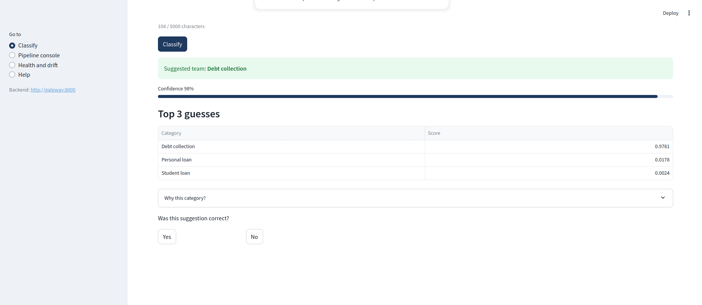
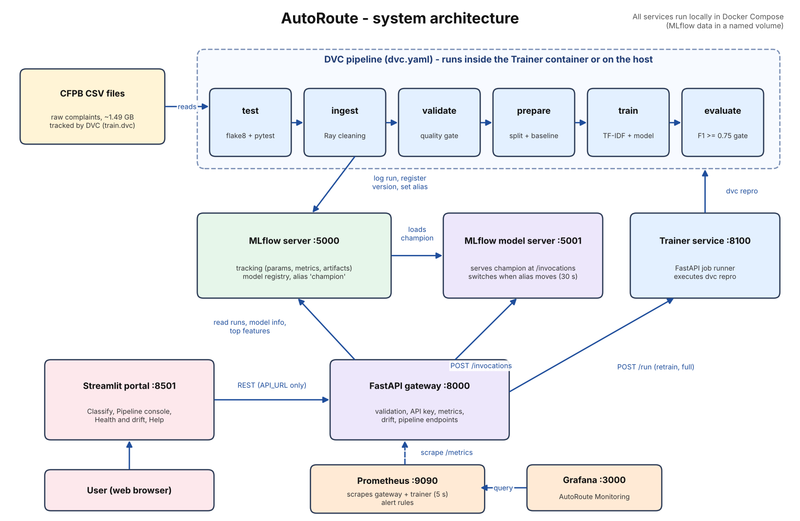
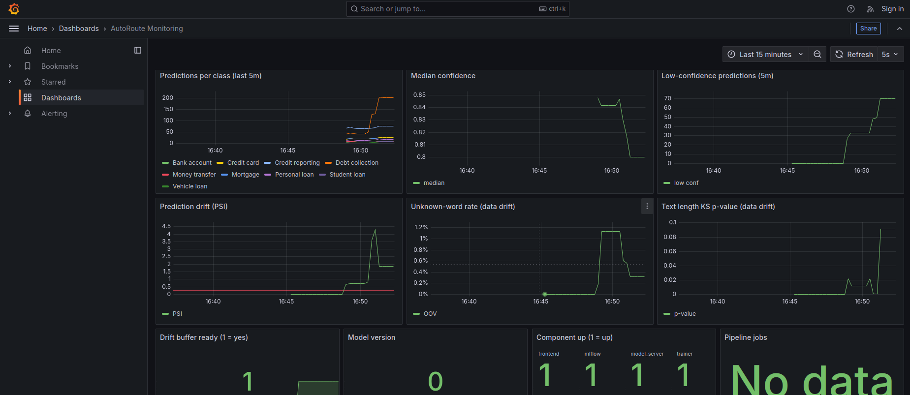
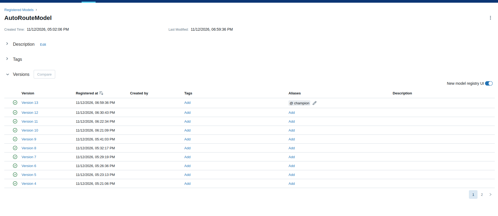

# AutoRoute: an AIOps customer-complaint classifier

AutoRoute reads a customer complaint written as free text and suggests **which product team should handle it**
(credit reporting, debt collection, credit card, mortgage, bank account, money transfer, vehicle loan, student loan,
personal loan), together with a confidence score and the words behind the suggestion.

The model is deliberately simple (TF-IDF + logistic regression). The project is about everything *around* the model:
a versioned and tested pipeline, experiment tracking, model serving, drift monitoring, and packaging. Everything runs
locally (no cloud service) under Docker Compose. Built for the course **DA3408 - AI Operations**.

| | |
|---|---|
| **Student** | `Vudutha M Shivaarchitha` (`DA24B052`) |
| **Course** | DA3408 |
| **Data** | CFPB Consumer Complaint Database, narratives archive (public data, 847,887 complaints with text, 9 classes) |

## Results at a glance

| Item | Result |
|---|---|
| Macro F1 on the held-out test set (target: at least 0.75) | **0.8322** (accuracy 0.8368), champion model version 13 |
| p95 prediction latency through the gateway (target: below 300 ms) | **12.9 ms** (200 requests) |
| Automated tests / code style | **59 tests passed, 0 failed**; flake8 reports 0 issues |
| Data-quality gate on the real data | 0 hard failures (duplicates 21.9 %, imbalance 42.3 : 1) |
| Ray vs plain Python for text cleaning (50,000-row sample) | 1.46 times faster; all 847,906 rows cleaned in 18.9 s |
| Experiments tracked in MLflow | 13 registered model versions (logistic regression, linear SVM, naive Bayes) |



## Architecture



| Service | Port | Job |
|---|---|---|
| `frontend` (Streamlit) | 8501 | Web portal: Classify, Pipeline console, Health and drift, Help. Talks to the gateway only (`API_URL`) |
| `gateway` (FastAPI) | 8000 | Validation, optional API key, metrics, drift detection, feedback, explanations, pipeline endpoints (`/docs` shows the API) |
| `model-server` (`mlflow models serve`) | 5001 | Serves the model with the alias `champion`; switches automatically when the alias moves |
| `mlflow` | 5000 | Experiment tracking and model registry |
| `trainer` (FastAPI + DVC) | 8100 | Runs the DVC pipeline when you press *Retrain* (keeps training away from the prediction path) |
| `prometheus` | 9090 | Scrapes metrics every 5 s, evaluates 6 alert rules |
| `grafana` | 3000 | Live dashboard "AutoRoute Monitoring" (login `admin` / `admin`) |

The ML pipeline (`dvc.yaml`) has six stages: `test` (flake8 + pytest) -> `ingest` (Ray) -> `validate` (data-quality gate)
-> `prepare` (split + drift baseline) -> `train` (TF-IDF + model, logged to MLflow) -> `evaluate` (promote to
`champion` only if macro F1 >= 0.75 and not worse than the current champion).

## Repository layout

```
.
├── README.md                 this file
├── dvc.yaml, dvc.lock        the 6-stage pipeline and its locked results
├── params.yaml               all tunable settings (workers, class cap, TF-IDF size, model type, thresholds)
├── label_map.yaml            raw CFPB product names -> 9 class names
├── docker-compose.yml        the 7 services, ports, memory limits, health checks
├── Dockerfile.{mlflow,gateway,frontend,trainer}
├── .env.example              copy to .env (host user id, optional API key / encryption key)
├── requirements.txt          everything for the host virtual environment
├── requirements-{trainer,serving,gateway,frontend}.txt   pinned packages for each container image
├── MLproject, python_env.yaml   MLflow Project description
├── metrics.json, models/*.json, reports/*.json|txt, data/interim/*.json
│                             small result files written by the pipeline and kept in Git on purpose (DVC metrics)
├── data/raw/train.dvc        pointer to the training data (the data itself is NOT in Git)
├── src/                      pipeline code: ingest (Ray), validate_data, prepare, train, evaluate, model_wrapper, text_utils, eda
├── gateway/                  FastAPI gateway (main, schemas, drift, feedback, metrics, mlflow_client, config)
├── trainer/app.py            REST job runner around `dvc repro`
├── frontend/app.py           Streamlit portal
├── serving/                  entrypoint.sh + get_champion.py (model-server start and automatic switch-over)
├── monitoring/               Prometheus config, alert rules, Grafana provisioning and dashboard
├── scripts/                  run_checks.py (CI stage), download_data.sh, replay.py, latency_check.py,
│                             set_champion.py (rollback), reorganize_docs.py, check_docs_links.py
├── tests/                    59 pytest tests
└── docs/
    ├── 01_ARCHITECTURE.md ... 06_DATA_CARD.md    the design documents (Markdown)
    ├── pdf/                  the same documents as PDF (for submission)
    ├── diagrams/             architecture, sequence and retraining diagrams
    ├── screenshots/          evidence from the running system
    ├── eda/                  charts and summary from src/eda.py
    └── test_report.txt       raw output of `python -m pytest -v`
```

Two folders have similar names: **`reports/`** (repository root) holds the CI results that the DVC `test` stage writes
(`ci_summary.json`, `test_output.txt`); **`docs/pdf/`** holds the PDF documents.

## Prerequisites

* Linux (developed and tested on Ubuntu in a VirtualBox VM: 4 CPUs, 8 GB RAM, 60 GB disk recommended)
* Docker Engine with the Compose plugin (`docker compose version` must work without `sudo`)
* Python 3.10 or newer with `venv` (tested with 3.12 on the host; the containers use 3.10), `git`, `wget`, `unzip`
* About 10 GB of free disk space (data 1.5 GB, Docker images, DVC cache)

## Quick start

All commands are run in the repository root.
**1. Get the code and install the tools**

```bash
git clone https://github.com/shivaarchithavudutha/AutoRoute_aiops_finalproject.git
cd AutoRoute_aiops_finalproject
python3.12 -m venv venv
source venv/bin/activate              # repeat this line in every new terminal
pip install --upgrade pip
pip install -r requirements.txt       # 5-15 minutes; versions are pinned on purpose
mkdir -p data/raw/train data/raw/production data/interim data/processed
cp .env.example .env
id -u; id -g                          # put these two numbers into .env as HOST_UID and HOST_GID
```

**2. Get the data** (not stored in Git; about 1.5 GB after unzipping)

```bash
sh scripts/download_data.sh           # downloads the two CFPB narrative exports into data/raw/train
dvc status data/raw/train.dvc         # should print: Data and pipelines are up to date.
```

If that command reports that `data/raw/train` changed (the CFPB may re-issue its files), run `dvc add data/raw/train`
once. The pointer `data/raw/train.dvc` of the original run is `md5: b4b67e24ce7345f60ad8351e604a854f.dir` (3 files, 1,491,760,530 bytes).
No DVC remote is configured, so `dvc pull` is not used; the download script is the data source.

*No time or disk for the real data?* Use a fake data set instead, with the same columns:
`python src/make_sample_data.py 20000` (skip `download_data.sh`). The scores are then meaningless (F1 close to 1.0) but the whole system works.

**3. Start MLflow, then run the pipeline**

```bash
docker compose up -d --build mlflow   # first build takes 5-10 minutes
export MLFLOW_TRACKING_URI=http://localhost:5000     # repeat in every new terminal
dvc repro                             # test -> ingest -> validate -> prepare -> train -> evaluate
```

The last line printed by the pipeline should read `PROMOTED version 1 to 'champion' (macro_f1 ...)`.
Expect about 5 to 20 minutes on the real data, depending on the machine.

**4. Start everything**

```bash
docker compose up -d --build          # first build takes 10-25 minutes (the trainer image is large)
docker compose ps                     # all services should be running / healthy
docker compose logs -f --tail=20 model-server    # wait for: champion is now version N
```

**5. Open the application**

| What | Address |
|---|---|
| Web portal | http://localhost:8501 |
| API documentation | http://localhost:8000/docs |
| MLflow | http://localhost:5000 |
| Prometheus (targets, alerts) | http://localhost:9090 |
| Grafana (Dashboards, AutoRoute Monitoring) | http://localhost:3000 |

Stop everything with `docker compose down` (the MLflow data stay in a Docker volume; `docker compose down -v` deletes them).

## Using the system

* **Classify:** open the portal, pick an example or paste a complaint, press *Classify*. The result shows the team, the confidence,
  the top-3 guesses, the words behind the suggestion ("Why this category?") and Yes/No feedback buttons. See [the user manual](docs/05_USER_MANUAL.md).
* **Retrain:** *Pipeline console* -> *Retrain model* (or `curl -X POST localhost:8000/pipeline/trigger -H "Content-Type: application/json" -d '{"action":"retrain"}'`).
  A new version becomes `champion` only if it passes the gate; the model server switches within about 30 s.
* **Roll back:** `python scripts/set_champion.py` lists versions; `python scripts/set_champion.py <version>` moves the alias.
* **Drift demo:** send normal traffic, then traffic of one class only, and watch Grafana and the *Health and drift* page:

```bash
python scripts/replay.py --dir data/raw/train --n 200
python scripts/replay.py --dir data/raw/train --n 200 --product "Debt collection"
```

PSI above 0.25 turns the *PredictionDrift* alert on at http://localhost:9090/alerts after about 30 s.

## Tests and quality checks

```bash
python -m pytest -v | tee docs/test_report.txt   # 59 tests
flake8 .                                         # prints nothing when the code follows PEP8
python scripts/latency_check.py 200              # needs the system running; prints PASS/FAIL against 300 ms
python scripts/check_docs_links.py               # checks that links in README.md and docs/*.md resolve
```

`dvc repro` runs flake8 and pytest as its first stage and writes `reports/ci_summary.json`; later stages depend on it, so failing code never trains a model.

## Configuration

* `params.yaml`: pipeline and model settings (for example `train.model_type`: `logistic_regression`, `linear_svm` or `naive_bayes`; `train.C`; `prepare.max_rows_per_class`; `evaluate.min_macro_f1`).
  Change one value, commit, run `dvc repro`: DVC re-runs only the affected stages and MLflow records a new run.
* `label_map.yaml`: how raw product names map to the 9 classes.
* `.env`: `HOST_UID` / `HOST_GID` (must match `id -u` / `id -g`, otherwise the trainer container cannot write to the project folder),
  optional `API_KEY`, optional `MODEL_ENCRYPTION_KEY`, optional `AUTO_RETRAIN_ON_DRIFT`.
* Services find each other through environment variables set in `docker-compose.yml` (`API_URL`, `MODEL_SERVER_URL`, `MLFLOW_TRACKING_URI`, `TRAINER_URL`).

## Reproducibility

Every MLflow run stores the Git commit hash and the hash of the training data as tags, plus `params.yaml` as an artifact.
To rebuild an old result: `git checkout <commit>` -> `dvc checkout` (or re-download the data) -> `dvc repro`.
Package versions are pinned in the requirements files.

## Documentation

| Document | Markdown | PDF |
|---|---|---|
| 1. Architecture diagram and block explanation | [docs/01_ARCHITECTURE.md](docs/01_ARCHITECTURE.md) | [pdf](docs/pdf/AutoRoute_01_ARCHITECTURE.pdf) |
| 2. High-level design | [docs/02_HLD.md](docs/02_HLD.md) | [pdf](docs/pdf/AutoRoute_02_HLD.pdf) |
| 3. Low-level design (endpoints, I/O) | [docs/03_LLD.md](docs/03_LLD.md) | [pdf](docs/pdf/AutoRoute_03_LLD.pdf) |
| 4. Test plan, test cases and report | [docs/04_TEST_PLAN.md](docs/04_TEST_PLAN.md) | [pdf](docs/pdf/AutoRoute_04_TEST_PLAN.pdf) |
| 5. User manual | [docs/05_USER_MANUAL.md](docs/05_USER_MANUAL.md) | [pdf](docs/pdf/AutoRoute_05_USER_MANUAL.pdf) |
| Supporting: data card | [docs/06_DATA_CARD.md](docs/06_DATA_CARD.md) | [pdf](docs/pdf/AutoRoute_06_DATA_CARD.pdf) |

Raw test output: [docs/test_report.txt](docs/test_report.txt). EDA: [docs/eda/eda_summary.md](docs/eda/eda_summary.md).




## Where each evaluation item is implemented

| Evaluation area | Where |
|---|---|
| UI and pipeline visualization | `frontend/app.py` (Classify, Pipeline console with DAG, job history, speed and quality numbers, Health and drift, Help) |
| Frontend / backend loose coupling | separate containers; the portal knows only `API_URL` and calls the gateway over REST |
| Design documents, LLD with endpoint I/O | `docs/01_ARCHITECTURE.md` to `docs/03_LLD.md` |
| Code quality, logging, exceptions, unit tests | flake8-clean code, logging in every service, `tests/` |
| Data engineering with Ray | `src/ingest.py` (benchmark in `data/interim/ingest_metrics.json`) |
| DVC pipeline, DAG, versioning | `dvc.yaml`, `dvc.lock`, `data/raw/train.dvc`, `dvc dag` |
| Experiment tracking | `src/train.py` (parameters, metrics, artifacts, tags beyond autolog) |
| Prometheus and Grafana | `gateway/metrics.py`, `monitoring/` |
| MLflow serving, MLproject, FastAPI, Docker, Compose | `serving/`, `MLproject`, `gateway/`, `Dockerfile.*`, `docker-compose.yml` |
| Test plan and report | `docs/04_TEST_PLAN.md`, `docs/test_report.txt`, `reports/` |

## Troubleshooting

| Symptom | Fix |
|---|---|
| `docker: permission denied` | `sudo usermod -aG docker $USER`, then log out and in |
| `dvc repro`: connection refused to localhost:5000 | `docker compose up -d mlflow` and `export MLFLOW_TRACKING_URI=http://localhost:5000` |
| Portal says "Model server unavailable" | No champion model yet: run `dvc repro` first, then wait up to 30 s; check `docker compose logs model-server` |
| Retrain job fails with `getpwuid(): uid not found` | `HOST_UID` / `HOST_GID` in `.env` do not match your user (`id -u`, `id -g`); fix `.env`, then `docker compose up -d --build trainer` |
| `Killed` during ingest or train | Out of memory: lower `prepare.max_rows_per_class` and `ingest.workers` in `params.yaml`, or give the VM more RAM |
| Port already in use | `sudo ss -ltnp | grep :8501` (or 5000, 8000, 3000, 9090) and stop the other program |
| Grafana shows no data | Send traffic with `scripts/replay.py`; check http://localhost:9090/targets |
| Import errors after upgrading packages | Reinstall with `pip install -r requirements.txt` (the pins matter) |

## Known limitations

* Strong class imbalance (credit reporting is 57 % of the data); the weakest class is personal loan (F1 about 0.7).
* Only complaints with a published narrative are included; English text about US financial products only.
* Drift is measured as data drift (unknown-word rate, text length) and prediction drift (PSI); concept drift is not measured because production has no true labels (user feedback is only a small-sample signal).
* Not implemented: HTTPS, encryption of data files, Git LFS, Spark/Kubernetes, per-prediction explanations, scheduled retraining. Integration tests are manual.
* The Grafana panel "Model version" shows 0 until `/model/info` has been called once (the Pipeline console does this).

## Data source and acknowledgements

Complaint data: Consumer Financial Protection Bureau, Consumer Complaint Database (narratives archive),
https://www.consumerfinance.gov/foia-requests/foia-electronic-reading-room/cfpb-consumer-complaint-database-narratives-archive/ .
Tools: DVC, Ray, MLflow, FastAPI, Streamlit, scikit-learn, Prometheus, Grafana, Docker.

## AI assistance disclosure

AI assistants (Claude, Gemini) helped plan the project and draft parts of the code, and documents.
They were also used in debugging and help me when I was stuck.
I ran, tested everything; all results, screenshots and numbers come from my own runs.

## Demo video link

*5-Minute Walkthrough Video:** [Watch Demo Video](https://drive.google.com/file/d/1iu_ToHodXHzyaeL4IO3zW0FO8A2nYWFN/view?usp=sharing)
