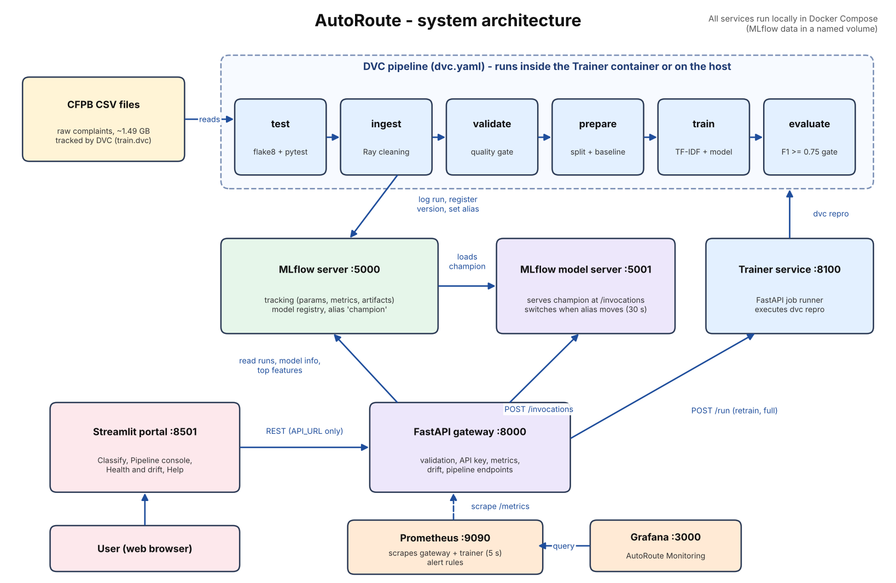
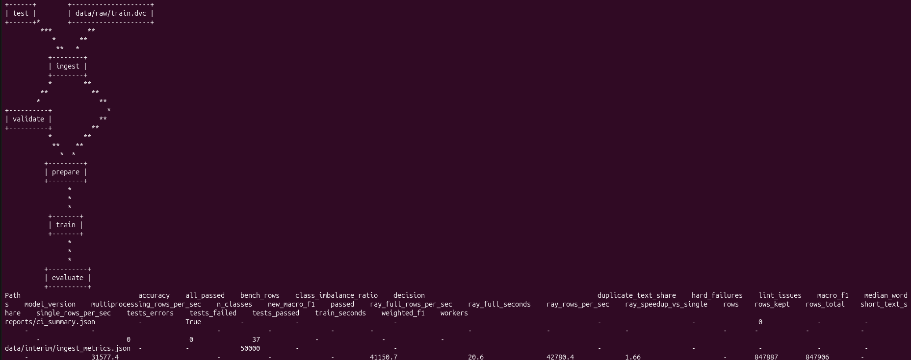

# Architecture Diagram and Block Explanation

## 1. Purpose

AutoRoute reads a customer complaint written as free text and suggests which product team should handle it (credit reporting, debt collection, credit card, mortgage, bank account, money transfer, vehicle loan, student loan or personal loan). The model is a TF-IDF + linear classifier. Most of the engineering effort goes into the system around it: a versioned pipeline, experiment tracking, model serving, monitoring, packaging and tests. This document shows the blocks of that system, what each block does and how the blocks talk to each other.

## 2. Architecture diagram

## 3. Services and ports

All services run on one machine (an Ubuntu virtual machine) under Docker Compose, so no cloud service is used.

| Service | Technology | Port | Memory limit | Main job |
|---|---|---|---|---|
| mlflow | MLflow server (SQLite + artifact folder in a Docker volume) | 5000 | 768 MB | Experiment tracking and model registry |
| model-server | `mlflow models serve` | 5001 | 1 GB | Serves the model that carries the alias `champion` |
| gateway | FastAPI | 8000 | 1 GB | Validation, API key, metrics, drift, pipeline endpoints |
| frontend | Streamlit | 8501 | 512 MB | Web portal for users |
| trainer | FastAPI + DVC | 8100 | 3 GB, 2 CPUs, 2 GB shared memory | Runs the DVC pipeline on request |
| prometheus | Prometheus 2.55 | 9090 | 512 MB | Collects metrics every 5 s, evaluates alert rules |
| grafana | Grafana 11.3 | 3000 | 512 MB | Live dashboard "AutoRoute Monitoring" |

## 4. Block explanations

**Data source (CFPB CSV files).** The training data are the public CFPB consumer-complaint narratives (three CSV files, about 1.49 GB). The folder `data/raw/train` is not stored in Git. DVC keeps the files in its cache and Git stores only the small pointer `data/raw/train.dvc`, so every Git commit identifies exactly which data version was used.

**DVC pipeline.** `dvc.yaml` defines six stages that run in a fixed order: `test`, `ingest`, `validate`, `prepare`, `train`, `evaluate`. DVC builds the dependency graph (DAG) from the declared inputs and outputs and re-runs only the stages whose code, data or parameters changed. The first stage (`test`) runs flake8 and pytest; every later stage depends on its summary file, so code that fails the checks never trains a model. This is the continuous-integration step of the project.

**Ray ingest.** The ingest stage reads the CSV files, keeps only rows that contain a complaint narrative, maps the raw product names to nine short class names (`label_map.yaml`) and cleans the text. The cleaning is split into chunks and executed in parallel by Ray. The stage also benchmarks plain Python, multiprocessing and Ray on a sample and stores the throughput in `ingest_metrics.json`.

**Validate and prepare.** `validate` is a data-quality gate: it checks required columns, minimum rows and classes, null values, too-short texts and duplicate texts, and warns about class imbalance and unparseable dates. A failed hard check stops the pipeline. `prepare` drops tiny classes, caps very large classes, makes a stratified 80/20 train/test split and creates the drift baseline (vocabulary, text-length sample, class mix) that the gateway later compares live traffic with.

**Train and evaluate.** `train` fits TF-IDF features and a linear model (logistic regression, linear SVM or naive Bayes, chosen in `params.yaml`), logs parameters, metrics, artifacts and tags to MLflow, and registers the model as a new version. `evaluate` applies the acceptance rule: a version becomes `champion` only if macro F1 is at least 0.75 and it is not worse than the current champion.

**MLflow server (tracking and registry).** Every run stores its parameters, metrics (accuracy, macro F1, per-class F1, training time, ingest and data-quality figures), artifacts (confusion matrix, top features per class, classification report, drift baseline, `params.yaml`) and tags (Git commit, data hash). The model registry keeps all versions of `AutoRouteModel`; the alias `champion` marks the version in production.

**MLflow model server.** This container runs `mlflow models serve` for the version that carries the alias `champion` and exposes it at `/invocations`. A small shell loop checks the alias every 30 seconds and restarts the server when the alias moves, which makes both promotion and rollback automatic.

**FastAPI gateway.** The gateway is the only door to the backend. It validates the request (1 to 5000 characters, not blank), checks the optional API key, calls the model server, returns the category, confidence and top-3 guesses, and records Prometheus metrics. It also keeps the rolling drift window, the user-feedback accuracy, explanations ("Why this category?") and the pipeline-console endpoints. If a backend service is down it returns a clear 502/503 message instead of crashing.

**Trainer service.** Training uses a lot of CPU and memory. It therefore runs in its own container with CPU and memory limits, so predictions in the gateway are not slowed down. The trainer exposes a small REST job runner: the actions `retrain` (train + evaluate) and `full` (the whole `dvc repro`).

**Streamlit portal.** The portal has four pages: Classify, Pipeline console, Health and drift, and Help. It knows only one setting, `API_URL`, and talks to the gateway through REST. It never imports backend code, so frontend and backend are loosely coupled and can be changed or scaled independently.

**Prometheus and Grafana.** Prometheus scrapes the gateway and the trainer every 5 seconds, stores the time series and evaluates six alert rules (prediction drift, data drift, component down, slow predictions, low live accuracy, high memory). Grafana reads from Prometheus and shows the live dashboard.

**Docker Compose.** `docker-compose.yml` starts all seven services with their ports, environment variables, health checks, memory limits and restart policy. The portal address of the gateway, the MLflow address and so on are passed as environment variables, so the same images run anywhere.

## 5. How the blocks are connected

| From | To | How | Purpose |
|---|---|---|---|
| User browser | Streamlit portal | HTTP :8501 | Use the application |
| Streamlit portal | Gateway | REST (`API_URL`) | Classify, feedback, explanations, drift and pipeline information |
| Gateway | Model server | REST `POST /invocations` | Get class probabilities |
| Gateway | MLflow server | MLflow client | Model info, recent runs, top features |
| Gateway | Trainer | REST `POST /run` | Start a retraining job |
| Trainer | DVC pipeline | `dvc repro` command | Run the stages |
| DVC pipeline | MLflow server | MLflow client | Log runs, register versions, move the alias |
| MLflow server | Model server | Model registry URI `models:/AutoRouteModel/<version>` | Load the champion |
| Prometheus | Gateway, trainer | HTTP `GET /metrics` every 5 s | Collect metrics |
| Grafana | Prometheus | PromQL queries | Draw dashboards |

## 6. The pipeline as DVC sees it

The output of `dvc dag` and `dvc metrics show` from the project virtual machine is shown below. The graph has the six stages in the order described above; the metrics table lists the values recorded by each stage.

