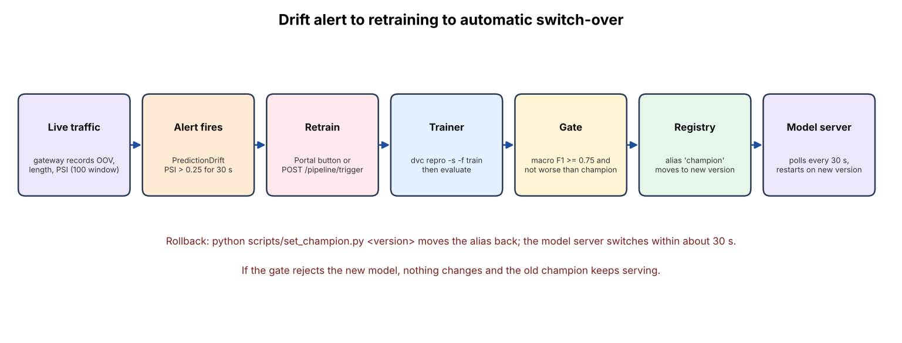

# High-Level Design (HLD)

## 1. Problem and goals

Companies receive thousands of complaints. A person must read each one and forward it to the right team. AutoRoute predicts the team from the complaint text and gives a confidence score, so that a support agent can route a complaint in seconds and check the uncertain ones.

The measurable success criteria are:

| Criterion | Target | Result obtained |
|---|---|---|
| Macro F1 on the held-out test set | at least 0.75 | 0.8322 (champion, version 13) |
| p95 latency of `/predict` through the gateway | below 300 ms | 12.9 ms (200 requests) |
| Pipeline reproducible from a Git commit | yes | commit hash and data hash stored as MLflow tags |
| All services monitored | yes | Prometheus targets and Grafana dashboard |

## 2. Users and use cases

- **Support agent:** pastes a complaint, receives the suggested team and confidence, sees the most typical words behind the suggestion and says whether the suggestion was correct.
- **ML engineer / administrator:** watches the health and drift page and the Grafana dashboard, starts retraining from the pipeline console, compares experiments in MLflow and rolls back a model if needed.

## 3. Architecture overview and data flows

The architecture diagram is in document 1. Three data flows matter.

**(a) A prediction.** The portal sends `POST /predict` to the gateway. The gateway validates the text, calls the model server, ranks the class probabilities, records metrics and the drift window, and returns the category, the confidence and the top three guesses. The detailed sequence is in the LLD.

**(b) A retraining run.** The engineer presses Retrain in the portal. The gateway forwards the request to the trainer service, which runs `dvc repro` for the train and evaluate stages. The new model is registered in MLflow. If it passes the acceptance gate it receives the alias `champion`, and the model server switches to it within about 30 seconds.

**(c) A drift alert.** Every prediction updates a rolling window of the last 100 requests in the gateway. When at least 50 requests are in the window, the gateway computes the population stability index (PSI), the unknown-word rate and a KS test on the text length. Prometheus scrapes these gauges every 5 seconds; when PSI stays above 0.25 for 30 seconds the alert `PredictionDrift` fires. The engineer then decides to retrain.

## 4. Technology choices and why

| Part | Chosen | Why | Alternative not chosen |
|---|---|---|---|
| Model | TF-IDF + logistic regression | Trains in minutes, so many experiments are possible; small containers; explainable through word weights; strong text baseline | BERT-type transformer: better accuracy possible, but slow to train, needs GPU or long CPU runs, large images. Kept as future work |
| Metric | Macro F1 | Classes are very imbalanced (credit reporting is about 57 % of rows); macro F1 gives every class the same weight | Accuracy: rewards always predicting the biggest class |
| Data versioning and pipeline | DVC | Versions big files outside Git, keeps a small pointer in Git, and defines the pipeline as a DAG so only changed stages re-run | Git LFS: stores large files but has no pipeline or stage caching |
| Parallel engine | Ray | Required by the course; same code scales from cores to machines | Plain Python or multiprocessing: no scale-out path (both are benchmarked as baselines). Spark: heavier set-up for this data size |
| Tracking and registry | MLflow | Runs, parameters, artifacts, model versions and aliases in one tool; comparison charts; model serving | Spreadsheet or folder naming: no history, no registry, no rollback |
| Model serving | `mlflow models serve` | Deploys the registered model as REST with no extra code | Loading the model inside the gateway: ties deployment to the gateway and blocks independent model updates |
| API layer | FastAPI gateway | Input validation (Pydantic), API key, metrics, drift and pipeline endpoints, automatic `/docs` | Calling the MLflow server directly from the portal: no validation, no metrics, tight coupling |
| UI | Streamlit | Fast to build in Python, simple pages | React front end: more code and tooling than the project needs |
| Monitoring | Prometheus + Grafana | Standard pull-based metrics, alert rules, live dashboards | Log-file analysis: not near real time |
| Packaging | Docker Compose | Separate services, limits, health checks on one machine | Kubernetes or Swarm: not needed for a single node; the guideline says "if applicable" |

## 5. Loose coupling

The Streamlit container has one setting that links it to the backend: `API_URL`. It uses only REST calls to the gateway and never imports backend modules. The gateway reaches the model server, MLflow and the trainer through three more environment variables (`MODEL_SERVER_URL`, `MLFLOW_TRACKING_URI`, `TRAINER_URL`). Each service can therefore be replaced, restarted or scaled without touching the others.

## 6. Data design

- **Source:** CFPB consumer-complaint database, narratives archive. Columns used: Date received, Product, Consumer complaint narrative.
- **After ingestion:** 847,887 complaints with a narrative, 9 classes (the 18 raw product names are merged in `label_map.yaml`).
- **Split:** classes with fewer than 2,000 rows are dropped (none were); each class is capped at 25,000 rows; the data are split 80/20 with stratification and a fixed seed (42). This gives about 192,800 rows in total, about 154,300 for training and 38,600 for testing.
- **Drift baseline** (`baseline.json`): class mix of the training data, vocabulary (words seen at least 3 times), and a sample of 5,000 training text lengths.

## 7. Model lifecycle

Train, then evaluate against the gate (macro F1 at least 0.75 and not worse than the current champion), then promote by moving the alias `champion`, then the model server switches automatically. A rejected model changes nothing, so the old champion keeps serving. To roll back, the alias is moved to an older version with `scripts/set_champion.py <version>`; the model server notices within about 30 seconds.

## 8. Monitoring design

| Group | Metrics | Meaning |
|---|---|---|
| System health | `requests_total`, `request_latency_seconds`, `component_up`, process CPU and memory | Traffic, speed, errors, health of model server, MLflow, trainer, frontend |
| Model behaviour | `predictions_total`, `prediction_confidence`, `low_confidence_total` | Which classes are predicted and how sure the model is |
| Data drift | `oov_rate`, `length_ks_pvalue` | Share of live words never seen in training; KS test of live text length against training |
| Prediction drift | `psi_prediction` | PSI between the live predicted-class mix and the training mix. Below 0.1 stable, 0.1 to 0.25 moderate, above 0.25 significant |
| Guard | `drift_buffer_ready` | 1 once at least 50 requests are in the window; PSI is meaningless with fewer |
| Live quality | `feedback_accuracy`, `feedback_window` | Share of recent predictions that users confirmed as correct |
| Pipeline | `trainer_jobs_total`, `trainer_running`, `auto_retrain_triggers_total` | Training jobs by status |

The system measures **data drift** and **prediction drift**. It does not claim to measure concept drift, because that needs true labels which are not available in production; the user feedback is only a small-sample signal.

Alert rules: `PredictionDrift` (PSI above 0.25), `DataDriftHighOOV` (unknown words above 30 %), `ComponentDown`, `SlowPredictions` (p95 above 300 ms), `LowLiveAccuracy` (below 70 % over at least 20 answers) and `GatewayHighMemory` (above 800 MB).

## 9. Deployment

Seven Docker Compose services with memory limits (document 1, section 3). MLflow data live in a named Docker volume, so `docker compose down` keeps the experiments. The gateway reads the drift baseline from `data/processed` mounted read-only; the trainer mounts the project folder so it can run `dvc repro` and write the results there.

## 10. Deployment strategy

The deployment is **online (real-time) serving through REST**, because a support agent needs the answer immediately while reading the complaint. Batch scoring is possible through the same API by sending many requests. Edge deployment was not chosen because the data and the model are small, no device is offline, and central deployment makes monitoring and updating simple.

## 11. Data quality

The `validate` stage checks required columns, minimum number of rows (1,000) and classes (2), null values, share of texts shorter than 5 words (at most 20 %) and share of duplicate texts (at most 30 %). Class imbalance (ratio above 500) and unparseable dates (above 1 %) only raise warnings. A hard failure stops the pipeline. For the real data the gate passed: 0 hard failures, 0.17 % short texts, 21.9 % duplicate texts, imbalance ratio 42.3. At run time the gateway watches the unknown-word rate and text-length distribution of live requests.

## 11b. Continuous integration inside DVC

The first DVC stage `test` runs `scripts/run_checks.py` (flake8 and pytest) and writes `reports/ci_summary.json`. Every later stage lists that file as a dependency, so a failing check stops `dvc repro` before ingestion or training. There is no external CI server because cloud services are not allowed in the course; this is stated openly.

## 12. Explainability

For each class the training run stores the 30 most indicative words and word pairs (`top_features.json`, taken from the model weights). The portal's "Why this category?" panel shows which of these terms occur in the user's text. This is a global explanation, not a per-prediction one; LIME or SHAP would be the next step.

## 13. Security

Implemented: optional API key in the header `X-API-Key`, input validation and length limit (5000 characters), no secrets in Git (settings come from `.env` and environment variables), and optional Fernet encryption of the stored model file (key from the environment). Not implemented, and named as future work: HTTPS between services and encryption of the data files.

## 14. Scalability

Ray can spread the cleaning step over more cores or machines. Services are separate containers, so the gateway or model server can be replicated behind a load balancer. Limits: one node, one gateway worker, and the drift window and feedback counters live in gateway memory (they refill after a restart). A larger deployment would add several gateway workers, a shared store for the counters and Kubernetes.

## 15. Production performance monitoring and retraining

Confidence statistics and the Yes/No feedback buttons feed a rolling accuracy gauge and an alert. Retraining is started by the Retrain button or by `POST /pipeline/trigger`; an optional setting (`AUTO_RETRAIN_ON_DRIFT=true`) starts the full pipeline automatically when PSI stays above 0.25, with a one-hour cooldown to avoid loops. Retraining only improves the model when new data were added to `data/raw/train`. There is no periodic schedule; a cron job calling the trigger endpoint would add one.

## 16. Risks and limitations

- Strong class imbalance: credit reporting is about 57 % of the complaints. The weakest class is personal loan (F1 about 0.69 to 0.70 in the logistic-regression runs).
- Only complaints whose authors agreed to publish a narrative are included; text is English and about US financial products; product names changed over the years and were merged by hand.
- PSI over a window of 100 requests is noisy for rare classes, which is why the guard of 50 requests exists.
- Integration and end-to-end tests are manual; the unit tests are automated.
- HTTPS, data encryption, Git LFS, Spark/Kubernetes and per-prediction explanations are not implemented.

