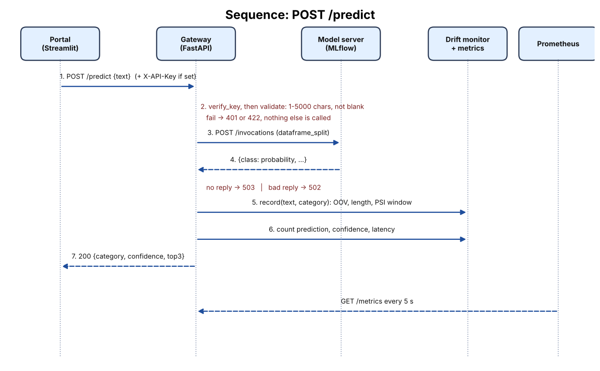

# Low-Level Design (LLD)

## 1. Scope

This document describes the interfaces and internals of AutoRoute: every REST endpoint with request, response and error codes, the modules and classes, the configuration, the pipeline stages with their inputs and outputs, the sequence of a prediction and the error handling. The running gateway documents itself at `http://localhost:8000/docs` (FastAPI/OpenAPI); the tables below match that page.

## 2. Gateway API (FastAPI, port 8000)

Base URL: `http://<host>:8000`. If the environment variable `API_KEY` is set, every endpoint except `/health` and `/metrics` requires the header `X-API-Key: <key>`; otherwise the gateway answers 401. Bodies are JSON.

| Endpoint | Method | Request | Success response | Error codes |
|---|---|---|---|---|
| `/health` | GET | none | 200 `{"status":"ok","components":{"model_server":true,"mlflow":true,"trainer":true,"frontend":true}}`. `status` is `degraded` when the model server is down | none |
| `/predict` | POST | `{"text": "<1-5000 characters, not blank>"}` | 200 `{"category","confidence","top3":[{"category","score"}]}` | 401 bad key; 422 empty, blank, missing or over-long text; 502 bad reply from model server; 503 model server unreachable |
| `/model/info` | GET | none | 200 `{"model_name","alias","version","run_id","macro_f1","accuracy","trained_at"}` | 401; 503 no champion model |
| `/drift/status` | GET | none | 200 `{"enabled","buffer_size","buffer_ready","psi_prediction","oov_rate","length_ks_pvalue"}` (the three statistics are `null` until the buffer is ready) | 401 |
| `/feedback` | POST | `{"predicted":"Mortgage","correct":true}` | 200 `{"window":12,"accuracy":0.83}` | 401; 422 invalid body |
| `/feedback/stats` | GET | none | 200 `{"window":12,"accuracy":0.83}` (`accuracy` is `null` with no answers) | 401 |
| `/explain` | POST | `{"text":"...","category":"Debt collection"}` | 200 `{"category","matched_terms":[...],"top_terms":[...]}` | 401; 422; 503 explanation unavailable |
| `/pipeline/summary` | GET | none | 200 `{"run_id":"...","metrics":{"ingest_ray_full_rows_per_sec":...,"train_seconds":...,"dq_rows":...}}` | 401; 503 MLflow down |
| `/pipeline/runs` | GET | query `?limit=20` | 200 list of `{"run_id","model","status","commit","macro_f1","duration_s","started"}` | 401; 503 MLflow down |
| `/pipeline/jobs` | GET | none | 200 list of `{"job_id","action","status","started","finished","duration_s"}` (newest first) | 401; 503 trainer down |
| `/pipeline/status` | GET | none | 200 latest job including `log_tail`, or `{"status":"idle"}` | 401; 503 trainer down |
| `/pipeline/trigger` | POST | `{"action":"retrain"}` or `{"action":"full"}` | 202 `{"job_id":"1b7535e0","status":"running"}` | 401; 409 a job is already running; 422 unknown action; 503 trainer down |
| `/metrics` | GET | none | 200 Prometheus text format | none |

### Examples

Prediction request and response (values from the classification shown in the user manual):

```
POST /predict
{"text": "A debt collector keeps calling me at work even after I asked them to stop."}

200 OK
{"category": "Debt collection", "confidence": 0.9781,
 "top3": [{"category": "Debt collection", "score": 0.9781},
          {"category": "Personal loan",   "score": 0.0178},
          {"category": "Student loan",    "score": 0.0024}]}
```

Error responses always have the form `{"detail": "<message>"}`:

```
POST /predict {"text": "   "}                422 Unprocessable Entity (text must not be empty)
POST /predict (5001 characters)               422 Unprocessable Entity
POST /predict (model server stopped)          503 {"detail": "Model server unavailable"}
POST /predict (wrong or missing X-API-Key)    401 {"detail": "Invalid or missing API key"}
POST /pipeline/trigger {"action": "foo"}      422 Unprocessable Entity
POST /pipeline/trigger (job running)          409 {"detail": "A job is already running"}
```

## 3. Model server (MLflow, port 5001)

`POST /invocations` with `{"dataframe_split": {"columns": ["narrative"], "data": [["complaint text"]]}}` returns `{"predictions": [{"<class>": probability, ...}]}` with one probability for each of the nine classes. `GET /ping` answers 200 when the server is ready. `serving/entrypoint.sh` starts `mlflow models serve -m models:/AutoRouteModel/<version>` and polls the alias `champion` every 30 seconds through `serving/get_champion.py`; when the version changes it stops and restarts the server on the new version.

## 4. Trainer service (FastAPI, port 8100)

| Endpoint | Method | Description | Errors |
|---|---|---|---|
| `/run` | POST | Body `{"action":"retrain"}` runs `dvc repro -s -f train` and then `dvc repro -s -f evaluate`; `{"action":"full"}` runs `dvc repro`. Starts a background thread and returns 202 `{"job_id","status":"running"}` | 409 job running; 422 unknown action |
| `/status` | GET | Latest job with `log_tail` (last 4000 characters of output) | none |
| `/jobs` | GET | Last 20 jobs, newest first | none |
| `/health` | GET | `{"status":"ok"}` | none |
| `/metrics` | GET | `trainer_jobs_total{status}`, `trainer_running`, process metrics | none |

A job has the states `running`, `success` or `failed`; a non-zero exit code of any command marks it `failed` and the output is kept in the log.

## 5. Modules and classes

| Module | Content | Responsibility |
|---|---|---|
| `src/text_utils.py` | `clean_text`, `tokens` | One cleaning function for pipeline, model and gateway (prevents train/serve skew); idempotent |
| `src/common.py` | `get_logger`, `load_params`, `map_label`, `git_commit`, `file_md5` | Shared helpers |
| `src/ingest.py` | `load_raw`, `clean_chunk`, `run_single`, `run_multiprocessing`, `run_ray`, `main` | Read CSVs, map labels, clean text in parallel, benchmark |
| `src/validate_data.py` | `run_checks`, `main` | Data-quality gate; writes `data_quality.json`; exit code 1 on a hard failure |
| `src/prepare.py` | `build_baseline`, `main` | Class filter and cap, stratified split, drift baseline |
| `src/train.py` | `build_pipeline`, `top_features`, `save_confusion_matrix`, `main` | Fit TF-IDF + model, log to MLflow, register the version |
| `src/model_wrapper.py` | class `AutoRouteModel(mlflow.pyfunc.PythonModel)` | Takes a DataFrame with column `narrative`, applies the same cleaning, returns class probabilities; decrypts an encrypted model file when the key is set |
| `src/evaluate.py` | `main` | Acceptance gate and alias promotion |
| `src/eda.py` | `main` | EDA charts and summary in `docs/eda/` |
| `gateway/main.py` | endpoints, `verify_key`, `track_requests` middleware, `call_model_server`, `component_status`, `maybe_auto_retrain`, `trainer_call` | HTTP layer, error mapping, metrics |
| `gateway/schemas.py` | `PredictRequest`, `PredictResponse`, `ClassScore`, `TriggerRequest`, `FeedbackRequest`, `ExplainRequest` | Request/response contract and validation |
| `gateway/drift.py` | function `psi`, class `DriftMonitor` | Rolling window and drift statistics |
| `gateway/feedback.py` | class `FeedbackTracker` | Rolling accuracy from user answers |
| `gateway/metrics.py` | Prometheus `Counter`, `Gauge`, `Histogram` objects | Metric definitions |
| `gateway/mlflow_client.py` | `champion_info`, `recent_runs`, `top_features`, `pipeline_summary` | Read-only MLflow queries |
| `gateway/config.py` | class `Settings` | All settings from environment variables |
| `trainer/app.py` | `run`, `execute`, `status`, `list_jobs` | Job runner around `dvc repro` |
| `frontend/app.py` | `call_api`, `page_classify`, `show_result`, `page_pipeline`, `page_drift`, `page_help` | Streamlit portal; only talks to the gateway |
| `scripts/` | `run_checks.py`, `replay.py`, `latency_check.py`, `set_champion.py`, `download_data.sh` | CI stage, traffic replay, latency test, rollback, data download |

### Main classes

- **`DriftMonitor(baseline, window=100, min_buffer=50)`** holds three deques of the last 100 requests (predicted label, text length, unknown-word share) and a lock. `record(text, predicted)` appends and calls `compute()`. `compute()` returns the statistics once at least 50 requests are buffered: PSI = sum over classes of (live share - training share) x ln(live share / training share) with a small epsilon of 1e-4, the mean unknown-word rate, and the p-value of a two-sample KS test of text length against the 5,000-length training sample. Without a baseline file the monitor is disabled and the gateway still runs.
- **`FeedbackTracker(window=50)`** keeps the last 50 Yes/No answers and returns `{"window", "accuracy"}`.
- **`AutoRouteModel`** is the MLflow Python model. `load_context` loads the scikit-learn pipeline (or decrypts `.enc` with `MODEL_ENCRYPTION_KEY`); `predict` cleans each text and returns `predict_proba` as a DataFrame with one column per class.

## 6. Sequence of `/predict`




## 7. Configuration (environment variables)

| Variable | Default | Used by | Meaning |
|---|---|---|---|
| `API_URL` | `http://localhost:8000` | frontend | The only link from the UI to the backend |
| `MODEL_SERVER_URL` | `http://localhost:5001` | gateway | Model server address |
| `MLFLOW_TRACKING_URI` | `http://localhost:5000` | gateway, trainer, model server | MLflow address |
| `TRAINER_URL` | `http://localhost:8100` | gateway | Trainer address |
| `BASELINE_PATH` | `data/processed/baseline.json` | gateway | Drift baseline file |
| `API_KEY` | empty (auth off) | gateway, frontend | Optional API key |
| `DRIFT_WINDOW`, `DRIFT_MIN_BUFFER` | 100, 50 | gateway | Rolling window size and minimum buffer |
| `LOW_CONFIDENCE` | 0.5 | gateway | Below this a prediction counts as low confidence |
| `FEEDBACK_WINDOW` | 50 | gateway | Number of recent answers for live accuracy |
| `AUTO_RETRAIN_ON_DRIFT`, `AUTO_RETRAIN_PSI`, `AUTO_RETRAIN_COOLDOWN_S` | false, 0.25, 3600 | gateway | Optional automatic retraining |
| `MODEL_ENCRYPTION_KEY` | empty | trainer, model server | Optional Fernet key for the stored model |
| `HOST_UID`, `HOST_GID` | 1000 | trainer | Makes files written by the container belong to the host user |

Pipeline settings are in `params.yaml` (ingest workers, class cap, split, TF-IDF size, model type, regularisation C, acceptance threshold, data-quality thresholds) and the label mapping in `label_map.yaml`.

## 8. Pipeline stages (`dvc.yaml`)

| Stage | Command | Main inputs | Outputs |
|---|---|---|---|
| test | `python scripts/run_checks.py` | `src`, `gateway`, `trainer`, `frontend`, `tests` | `reports/test_output.txt`, `reports/ci_summary.json` |
| ingest | `python src/ingest.py` | `data/raw/train`, `label_map.yaml`, `ci_summary.json` | `data/interim/clean.parquet`, `ingest_metrics.json` |
| validate | `python src/validate_data.py` | `clean.parquet` | `data/interim/data_quality.json` |
| prepare | `python src/prepare.py` | `clean.parquet`, `data_quality.json` | `train.parquet`, `test.parquet`, `baseline.json` |
| train | `python src/train.py` | `train.parquet`, `test.parquet`, `params.yaml` (features, train) | `models/run_info.json`, `metrics.json`; MLflow run and new model version |
| evaluate | `python src/evaluate.py` | `run_info.json`, `metrics.json` | `models/evaluation.json`; alias `champion` if accepted |

What `train` logs to MLflow: parameters (`features.*`, `train.*`), metrics (accuracy, macro F1, weighted F1, per-class F1, training time, ingest throughput, data-quality and CI numbers), artifacts (`confusion_matrix.png`, `classification_report.json`, `top_features.json`, `class_distribution.json`, `classes.json`, `params.yaml`, drift baseline, quality report) and tags (`git_commit`, data hash, `model_encrypted` when used).

## 9. Metrics exposed by the gateway

`requests_total{endpoint,status}`, `request_latency_seconds{endpoint}`, `predictions_total{category}`, `prediction_confidence`, `low_confidence_total`, `oov_rate`, `length_ks_pvalue`, `psi_prediction`, `drift_buffer_ready`, `model_version`, `component_up{component}`, `feedback_total{result}`, `feedback_accuracy`, `feedback_window`, `auto_retrain_triggers_total`, and the default process CPU and memory metrics. The trainer adds `trainer_jobs_total{status}` and `trainer_running`.

## 10. Error handling

| Situation | Where handled | Behaviour |
|---|---|---|
| Invalid, empty or oversized text | Pydantic model in the gateway | 422 before any other call |
| Wrong API key | `verify_key` dependency | 401 |
| Model server unreachable or timeout (10 s) | `call_model_server` | Logged; 503 "Model server unavailable"; portal shows a friendly message |
| Model server returns an error or malformed JSON | `call_model_server` | Logged; 502 |
| MLflow down | gateway endpoints that query MLflow | Logged; 503; `component_up{component="mlflow"}` becomes 0 |
| Trainer down or job already running | `trainer_call` | 503 or 409 passed to the portal |
| Unexpected exception in any request | `track_requests` middleware | Logged with stack trace; 500 `{"detail":"Internal server error"}`; counted in `requests_total` |
| Drift baseline file missing | `DriftMonitor.from_file` | Warning in the log; drift monitoring disabled; predictions continue |
| Hard data-quality failure | `validate_data.py` | Exit code 1; DVC stops the pipeline |
| Failing flake8 or pytest | `run_checks.py` | `dvc repro` stops at the `test` stage; details in `reports/test_output.txt` |
| Portal cannot reach the gateway | `call_api` in the frontend | "Cannot reach the AutoRoute service. Please try again in a moment." |
| Retraining job fails | `trainer/app.py` | Job state `failed`, output kept in the log, shown in the pipeline console |

