# Test Plan, Test Cases and Report

## 1. Scope and approach

**Scope:** text cleaning, label mapping, data validation, drift mathematics, the model wrapper, the gateway API (valid and invalid input, error mapping, security, metrics), feedback and explanation, the pipeline (DVC stages and gates), the monitoring stack and the end-to-end behaviour of the running system.

**Approach (three levels):**

| Level | How | Tool | When |
|---|---|---|---|
| Static analysis | PEP8 style check of all code | flake8 | Every `dvc repro` (stage `test`) |
| Unit and API tests | Automated tests; external services (model server, MLflow, trainer) are replaced by fakes with `monkeypatch` | pytest | Every `dvc repro` (stage `test`) and on demand |
| Integration, system and acceptance | Manual checks on the running Docker Compose stack, a latency script and the MLflow/Grafana/Prometheus screens | portal, `curl`, `scripts/latency_check.py`, `scripts/replay.py` | After each major change and before submission |

**Test environment:** Ubuntu virtual machine in VirtualBox; Python virtual environment with pinned packages (pytest 8.3.4, flake8 7.1.1, MLflow 2.22.0, scikit-learn 1.5.2); the seven Docker Compose services; the real CFPB data (847,887 cleaned complaints).

## 2. Acceptance criteria and results

| Criterion | Requirement | Result | Verdict |
|---|---|---|---|
| Model quality | Macro F1 on the held-out test set at least 0.75 | 0.8322 (accuracy 0.8368, weighted F1 0.8373), champion version 13 | **Pass** |
| Speed | p95 latency of `/predict` through the gateway below 300 ms (200 requests) | mean 11.0 ms, median 10.7 ms, p95 12.9 ms | **Pass** |
| Interface | All endpoints behave as in the LLD, errors are clean (no crash) | Checked by the automated API tests and manual calls | **Pass** |
| Code quality | flake8 reports no issue | 0 issues | **Pass** |
| Critical tests | All automated tests pass | See section 5 | **Pass** |
| Data quality | No hard data-quality failure on the real data | 0 hard failures | **Pass** |

## 3. Test cases (integration, system and acceptance)

Evidence figures are in section 6. "Auto" means the behaviour is also covered by the named automated test.

| ID | Description | Input / action | Expected | Actual | Pass/Fail |
|---|---|---|---|---|---|
| T01 | Classify an example complaint in the portal | Example "Debt collection", press Classify | Suggested team, confidence bar, top 3 | Debt collection, confidence 98 %, top 3 = 0.9781 / 0.0178 / 0.0024 (Fig. 1, 2) | Pass |
| T02 | Empty complaint | Blank text | 422 from the API; portal asks for text | 422 (Auto: `test_predict_empty_text_rejected`) | Pass |
| T03 | Text over 5000 characters | 5001 characters | 422; portal input limited to 5000 and shows a counter | 422 (Auto: `test_predict_too_long_rejected`); counter "104 / 5000 characters" visible (Fig. 1) | Pass |
| T04 | Text of exactly 5000 characters | 5000 characters | 200 | 200 (Auto: `test_predict_accepts_text_of_exactly_5000_characters`) | Pass |
| T05 | Model server down | Stop the model server, call `/predict` | 503 with a clear message; `/health` says degraded; portal shows a friendly error | 503 "Model server unavailable" (Auto: `test_model_server_down_returns_503`, `test_health_degraded_when_services_down`) | Pass |
| T06 | API key enforced | Key missing or wrong | 401 | 401 (Auto: `test_api_key_enforced`) | Pass |
| T07 | Component health page | Open Health and drift | Model server, MLflow, trainer, frontend shown as Up | All four Up (Fig. 5) | Pass |
| T08 | Metrics exposed and scraped | `GET /metrics`; Prometheus targets page | Custom metrics present; targets up | Names present (Auto: `test_metrics_endpoint_exposes_custom_metrics`); gateway, prometheus, trainer all 1/1 up (Fig. 9) | Pass |
| T09 | PSI for identical distribution | Same class mix | PSI close to 0 | PSI 0 (Auto: `test_psi_zero_for_identical_distribution`) | Pass |
| T10 | Drift guard | Fewer than 50 requests | `buffer_ready` false, no statistics | As expected (Auto: `test_buffer_not_ready_until_min_buffer`) | Pass |
| T11 | Drift detected end to end | Replay one-class traffic (`scripts/replay.py --product "Debt collection"`) | PSI above the red line 0.25 and alert fires | PSI rose to about 4.3 in Grafana and 2.317 on the portal ("significant"); alert `PredictionDrift` FIRING (Fig. 6, 7, 8) | Pass |
| T12 | Retrain trigger from the console | Press a pipeline button | Job runs and ends green | Job `1b7535e0` (action full) status success, 4.9 s (Fig. 4) | Pass |
| T13 | Failure is reported | Job fails (cause: container user had no entry for UID 1000) | Red state, error in the log, failure counted | Jobs `cf52592e` and `e8389d1f` shown as failed, "2 failed", log shows the error (Fig. 3). Cause fixed by running the trainer with `HOST_UID`/`HOST_GID`; the next job succeeded (T12) | Pass |
| T14 | Pipeline graph | `dvc dag` | Six stages in order test, ingest, validate, prepare, train, evaluate | As expected (Fig. 10) | Pass |
| T15 | CI gate | `dvc repro` first stage | Later stages depend on the test summary | `ci_summary.json`: `all_passed` true, 0 lint issues, 0 failed tests | Pass |
| T16 | Data-quality gate | Real data | No hard failure | `passed` true, 0 hard failures; short texts 0.17 %, duplicates 21.9 %, imbalance 42.3 (warning level 500) | Pass |
| T17 | Promotion gate | Evaluate stage | Version becomes champion only if F1 at least 0.75 and not worse | "PROMOTED version 13 to champion (macro_f1 0.8322)"; registry shows the alias on version 13 only (Fig. 11) | Pass |
| T18 | Rollback | Move the alias to an older version with `scripts/set_champion.py` | Model server switches within about 30 s | Alias moved, model server restarted on that version (guide Part 5.4 check) | Pass |
| T19 | Experiment tracking | Several runs with changed parameters | Each run stored; runs comparable | 13 model versions registered; 11 runs compared in the list and 6 in the compare view with parameters and metrics (Fig. 12, 13) | Pass |
| T20 | Acceptance: macro F1 | Held-out test set | At least 0.75 | 0.8322 | Pass |
| T21 | Acceptance: latency | `python scripts/latency_check.py 200` | p95 below 300 ms | p95 = 12.9 ms (Fig. 14) | Pass |
| T22 | Ray ingest benchmark recorded | Ingest stage | Throughput of Python, multiprocessing, Ray stored | 25,455 / 26,620 / 37,232 rows/s on 50,000 rows (Ray 1.46 times plain Python); full ingest of 847,906 rows in 18.9 s | Pass |

## 4. Experiments (model selection tests)

Each experiment changes one setting in `params.yaml`, is committed before running, and creates one MLflow run. Values below are taken from the MLflow compare view and the pipeline console (Fig. 12, 13, 3).

| Model | Settings | Macro F1 | Accuracy | Training time |
|---|---|---|---|---|
| Logistic regression (champion, version 13) | C = 1, word pairs, 50,000 features, balanced weights | **0.8322** | 0.8368 | 182 s (run measured while other services were busy; an earlier identical run took 73 s) |
| Logistic regression | C = 0.5 | 0.828 | 0.833 | 60 s |
| Logistic regression | C = 2.0 | 0.831 | 0.836 | 84 s |
| Logistic regression | 20,000 features | 0.828 | 0.833 | 57 s |
| Logistic regression | 100,000 features | 0.831 | 0.836 | 88 s |
| Linear SVM | calibrated | 0.8318 | not shown | 423 s |
| Naive Bayes | alpha = 0.1 | 0.783 | 0.791 | 23 s |
| Naive Bayes | alpha = 0.5 | 0.779 | 0.789 | 23 s |

Logistic regression and linear SVM are close in quality; naive Bayes is much faster but about five points worse. The weakest class in every run is personal loan (F1 about 0.69 to 0.70), the strongest is mortgage (about 0.93 to 0.94).

## 5. Automated tests and report

The suite has **59 test functions** in 8 files; the full list with one line per test is in Appendix A.

| File | Tests | Area |
|---|---|---|
| `tests/test_text_utils.py` | 6 | Text cleaning |
| `tests/test_prepare_and_labels.py` | 2 | Label mapping and drift baseline |
| `tests/test_validate_data.py` | 5 | Data-quality gate |
| `tests/test_drift.py` | 6 | Drift mathematics (PSI, OOV, buffer) |
| `tests/test_wrapper.py` | 1 | MLflow model wrapper |
| `tests/test_gateway.py` | 10 | Gateway API: input, errors, security, metrics, health |
| `tests/test_feedback_explain.py` | 7 | Feedback, explanation, auto-retrain cooldown, model decryption |
| `tests/test_extra.py` | 22 | Extra API, drift and helper tests |

**Report**

| Item | Value |
|---|---|
| Date | 14 November 2026 |
| Git commit | 4550e01 ("Fix trainer container UID and add test report") |
| Total automated tests | 59 |
| Passed / failed | 59 / 0 |
| flake8 | 0 issues |
| Integration, system and acceptance cases (section 3) | 22 executed, 22 passed, 0 failed |
| Raw output | `docs/test_report.txt` (from `python -m pytest -v`) and `reports/test_output.txt` (written by the DVC stage `test`) |

Warnings in the pytest output come from third-party packages (deprecation notices in MLflow and Pydantic) and do not affect the results.

## 6. Evidence (screenshots from the running system)

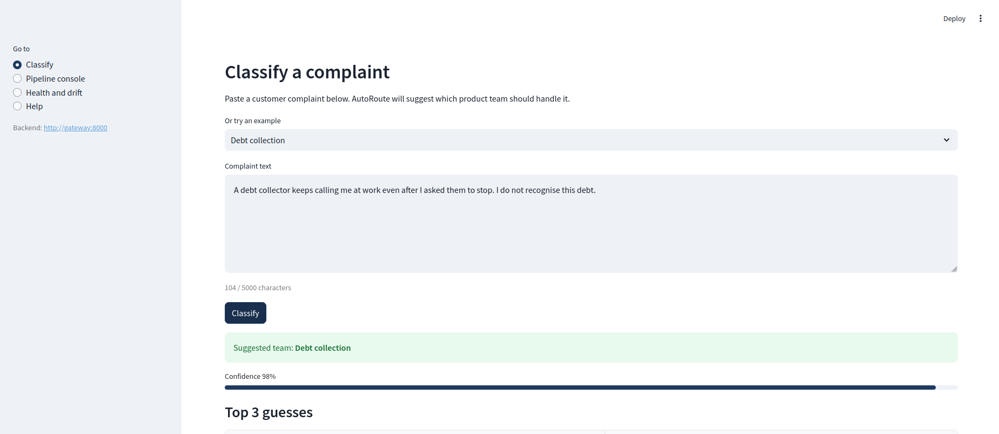

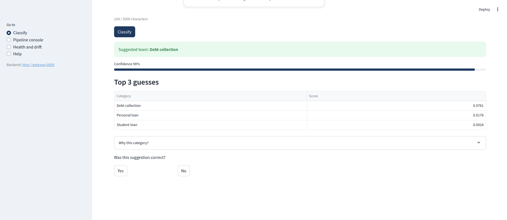

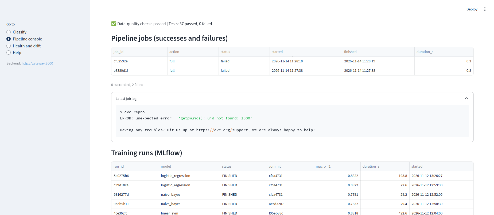

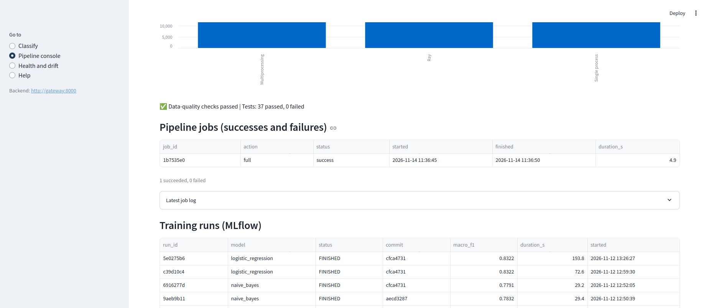

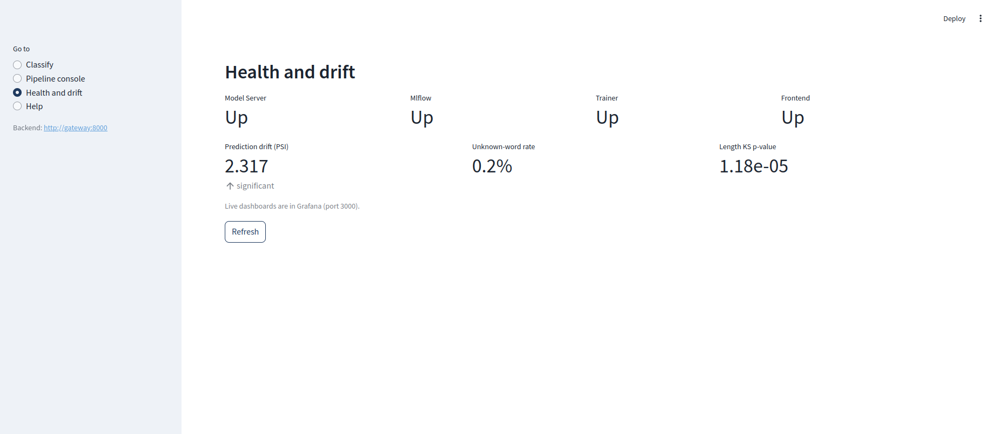

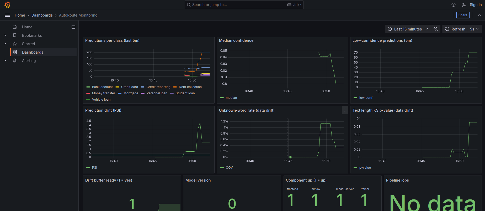

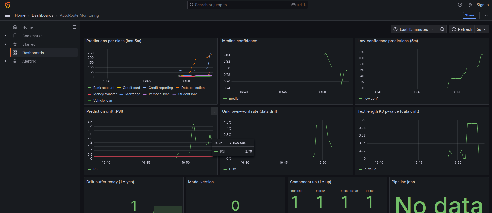

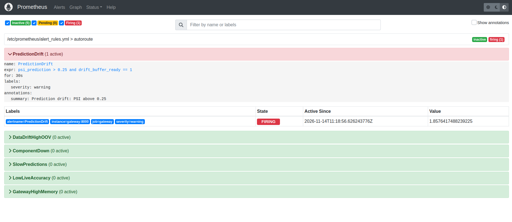

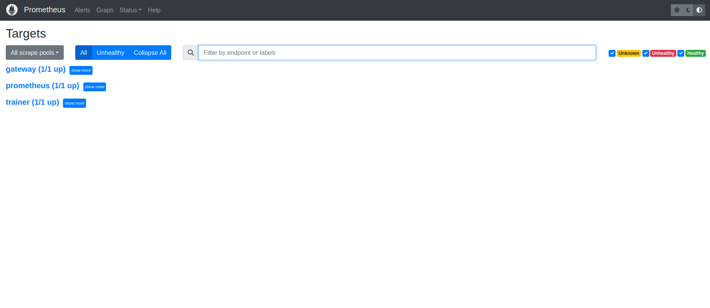

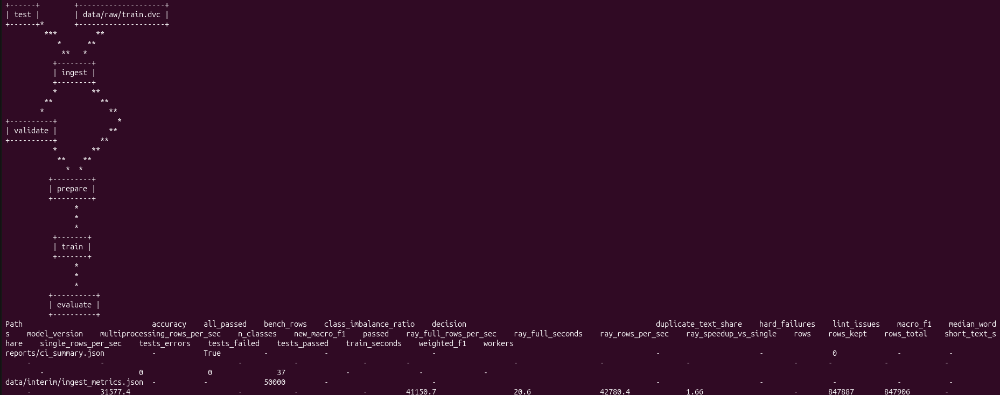

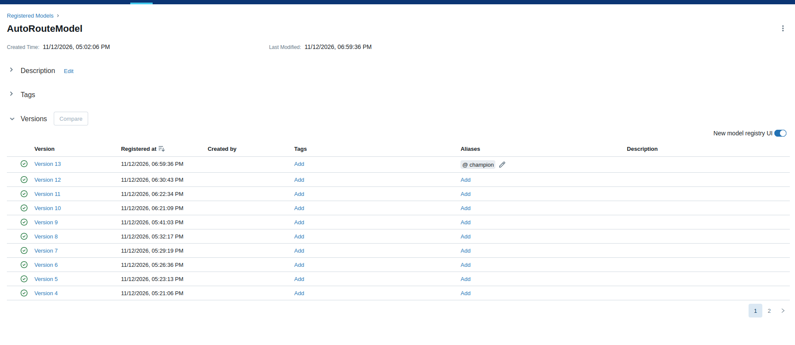

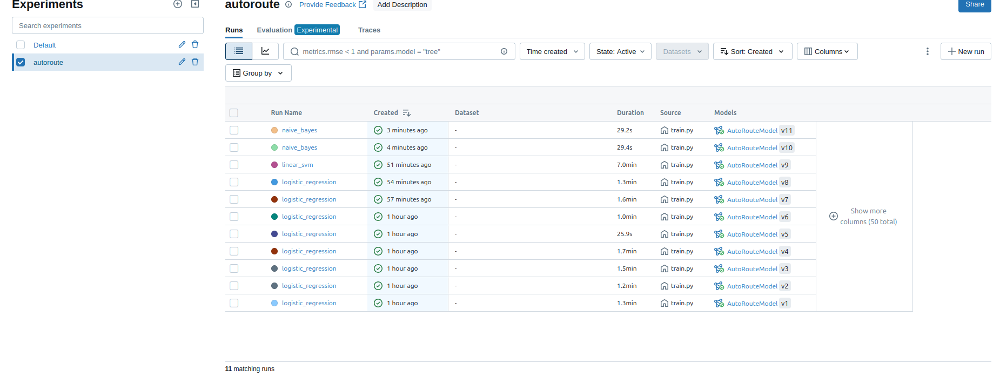

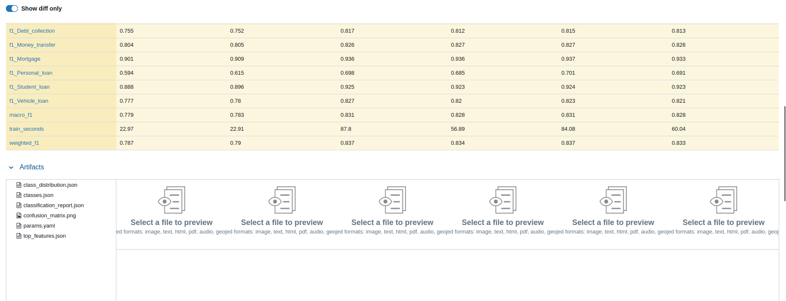

## 7. Observations and defects found during testing

| Finding | Cause | Action |
|---|---|---|
| Retrain jobs failed with `getpwuid(): uid not found: 1000` | The trainer container ran as a user id that had no entry inside the container | Fixed: the trainer runs with `HOST_UID` and `HOST_GID` from `.env`; later job succeeded (T12) |
| Grafana panel "Model version" shows 0 | The gateway sets `model_version` only when `/model/info` is called; the Pipeline console page calls it | Open the Pipeline console or call `/model/info` once; a possible improvement is to set the gauge at start-up |
| Drift numbers are large during the demo | The replay deliberately sends one class only | Expected; it is the demonstration of prediction drift |
| Integration and end-to-end tests are manual | No automated browser test | Listed as a limitation; the manual cases above are repeatable |

## Appendix A - All automated test functions

| No. | File | Test | What it checks | Result |
|---|---|---|---|---|
| 1 | `test_text_utils.py` | `test_lowercases_and_strips_punctuation` | Lowercases and strips punctuation | Pass |
| 2 | `test_text_utils.py` | `test_removes_redaction_tokens` | Removes redaction tokens | Pass |
| 3 | `test_text_utils.py` | `test_collapses_whitespace` | Collapses whitespace | Pass |
| 4 | `test_text_utils.py` | `test_none_and_empty` | None and empty | Pass |
| 5 | `test_text_utils.py` | `test_idempotent` | Idempotent | Pass |
| 6 | `test_text_utils.py` | `test_tokens` | Tokens | Pass |
| 7 | `test_prepare_and_labels.py` | `test_map_label_known_and_unknown` | Map label known and unknown | Pass |
| 8 | `test_prepare_and_labels.py` | `test_baseline_contents` | Baseline contents | Pass |
| 9 | `test_validate_data.py` | `test_good_data_passes` | Good data passes | Pass |
| 10 | `test_validate_data.py` | `test_too_few_rows_fails` | Too few rows fails | Pass |
| 11 | `test_validate_data.py` | `test_single_class_fails` | Single class fails | Pass |
| 12 | `test_validate_data.py` | `test_many_duplicates_fail` | Many duplicates fail | Pass |
| 13 | `test_validate_data.py` | `test_missing_columns_reported` | Missing columns reported | Pass |
| 14 | `test_drift.py` | `test_psi_zero_for_identical_distribution` | Psi zero for identical distribution | Pass |
| 15 | `test_drift.py` | `test_psi_large_for_shifted_distribution` | Psi large for shifted distribution | Pass |
| 16 | `test_drift.py` | `test_psi_handles_empty_class_without_error` | Psi handles empty class without error | Pass |
| 17 | `test_drift.py` | `test_buffer_not_ready_until_min_buffer` | Buffer not ready until min buffer | Pass |
| 18 | `test_drift.py` | `test_oov_rate_counts_unknown_words` | Oov rate counts unknown words | Pass |
| 19 | `test_drift.py` | `test_disabled_without_baseline` | Disabled without baseline | Pass |
| 20 | `test_wrapper.py` | `test_wrapper_returns_probability_dataframe` | Wrapper returns probability dataframe | Pass |
| 21 | `test_gateway.py` | `test_predict_ok` | Predict ok | Pass |
| 22 | `test_gateway.py` | `test_predict_empty_text_rejected` | Predict empty text rejected | Pass |
| 23 | `test_gateway.py` | `test_predict_too_long_rejected` | Predict too long rejected | Pass |
| 24 | `test_gateway.py` | `test_predict_missing_field_rejected` | Predict missing field rejected | Pass |
| 25 | `test_gateway.py` | `test_model_server_down_returns_503` | Model server down returns 503 | Pass |
| 26 | `test_gateway.py` | `test_api_key_enforced` | Api key enforced | Pass |
| 27 | `test_gateway.py` | `test_metrics_endpoint_exposes_custom_metrics` | Metrics endpoint exposes custom metrics | Pass |
| 28 | `test_gateway.py` | `test_health_degraded_when_services_down` | Health degraded when services down | Pass |
| 29 | `test_gateway.py` | `test_pipeline_trigger_rejects_bad_action` | Pipeline trigger rejects bad action | Pass |
| 30 | `test_gateway.py` | `test_pipeline_status_503_when_trainer_down` | Pipeline status 503 when trainer down | Pass |
| 31 | `test_feedback_explain.py` | `test_feedback_tracker_rolling_accuracy` | Feedback tracker rolling accuracy | Pass |
| 32 | `test_feedback_explain.py` | `test_feedback_endpoint` | Feedback endpoint | Pass |
| 33 | `test_feedback_explain.py` | `test_feedback_endpoint_validation` | Feedback endpoint validation | Pass |
| 34 | `test_feedback_explain.py` | `test_explain_returns_matched_terms` | Explain returns matched terms | Pass |
| 35 | `test_feedback_explain.py` | `test_explain_unavailable_returns_503` | Explain unavailable returns 503 | Pass |
| 36 | `test_feedback_explain.py` | `test_auto_retrain_respects_flag_and_cooldown` | Auto retrain respects flag and cooldown | Pass |
| 37 | `test_feedback_explain.py` | `test_wrapper_decrypts_encrypted_model` | Wrapper decrypts encrypted model | Pass |
| 38 | `test_extra.py` | `test_predict_returns_highest_probability_first` | Predict returns highest probability first | Pass |
| 39 | `test_extra.py` | `test_predict_top3_has_three_items_when_many_classes` | Predict top3 has three items when many classes | Pass |
| 40 | `test_extra.py` | `test_predict_top3_has_two_items_when_two_classes` | Predict top3 has two items when two classes | Pass |
| 41 | `test_extra.py` | `test_predict_accepts_text_of_exactly_5000_characters` | Predict accepts text of exactly 5000 characters | Pass |
| 42 | `test_extra.py` | `test_predict_accepts_unicode_text` | Predict accepts unicode text | Pass |
| 43 | `test_extra.py` | `test_low_confidence_counter_increments` | Low confidence counter increments | Pass |
| 44 | `test_extra.py` | `test_model_server_error_status_becomes_502` | Model server error status becomes 502 | Pass |
| 45 | `test_extra.py` | `test_model_server_bad_json_becomes_502` | Model server bad json becomes 502 | Pass |
| 46 | `test_extra.py` | `test_model_server_empty_predictions_becomes_502` | Model server empty predictions becomes 502 | Pass |
| 47 | `test_extra.py` | `test_model_info_returns_champion_details` | Model info returns champion details | Pass |
| 48 | `test_extra.py` | `test_model_info_503_when_no_champion` | Model info 503 when no champion | Pass |
| 49 | `test_extra.py` | `test_pipeline_runs_returns_list_and_passes_limit` | Pipeline runs returns list and passes limit | Pass |
| 50 | `test_extra.py` | `test_pipeline_runs_503_when_mlflow_down` | Pipeline runs 503 when mlflow down | Pass |
| 51 | `test_extra.py` | `test_pipeline_trigger_forwards_to_trainer` | Pipeline trigger forwards to trainer | Pass |
| 52 | `test_extra.py` | `test_pipeline_trigger_passes_through_409_when_busy` | Pipeline trigger passes through 409 when busy | Pass |
| 53 | `test_extra.py` | `test_ks_pvalue_high_when_lengths_match_training` | Ks pvalue high when lengths match training | Pass |
| 54 | `test_extra.py` | `test_ks_pvalue_low_when_lengths_shift` | Ks pvalue low when lengths shift | Pass |
| 55 | `test_extra.py` | `test_oov_rate_zero_for_known_words_and_one_for_unknown_words` | Oov rate zero for known words and one for unknown words | Pass |
| 56 | `test_extra.py` | `test_drift_window_keeps_only_most_recent_requests` | Drift window keeps only most recent requests | Pass |
| 57 | `test_extra.py` | `test_psi_grows_as_distribution_skews_more` | Psi grows as distribution skews more | Pass |
| 58 | `test_extra.py` | `test_clean_text_handles_accents_and_numbers` | Clean text handles accents and numbers | Pass |
| 59 | `test_extra.py` | `test_map_label_strips_whitespace` | Map label strips whitespace | Pass |

