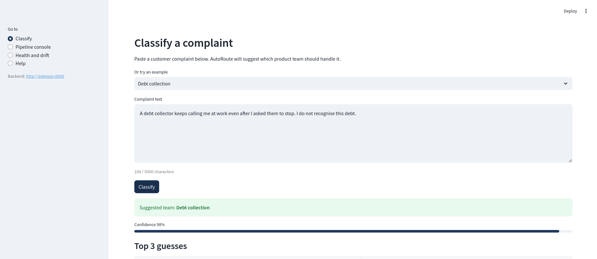
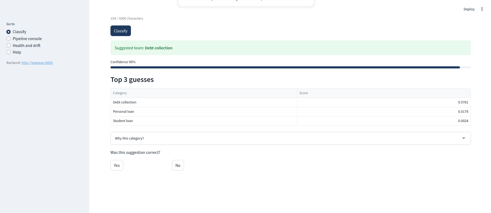
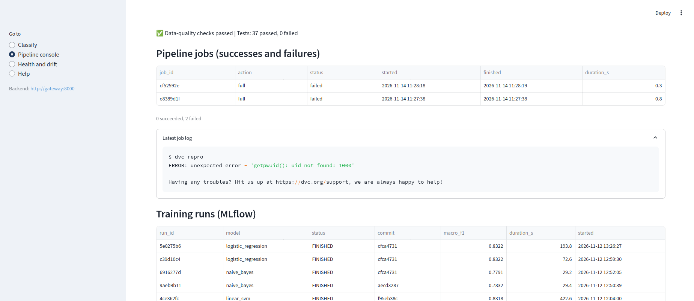
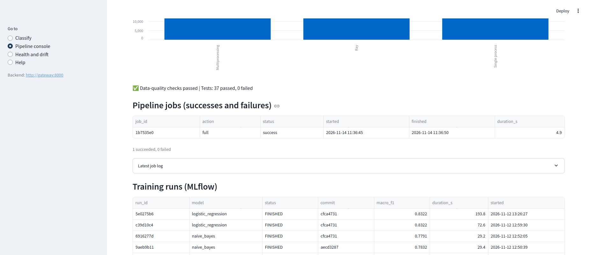
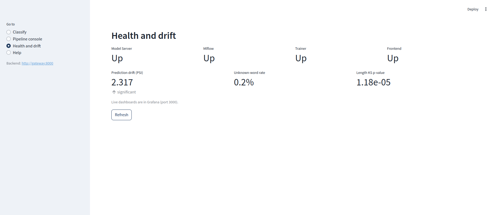
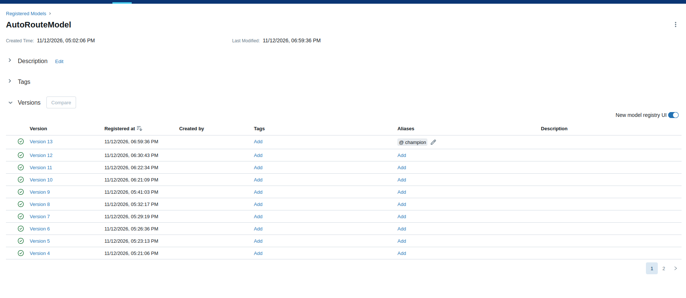
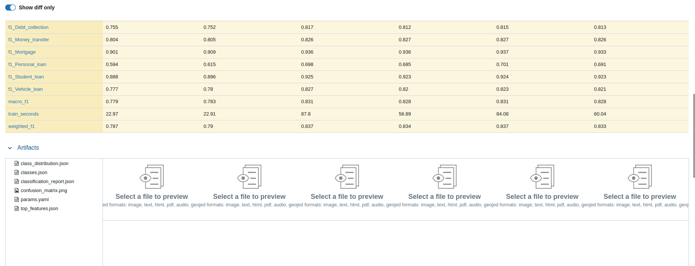
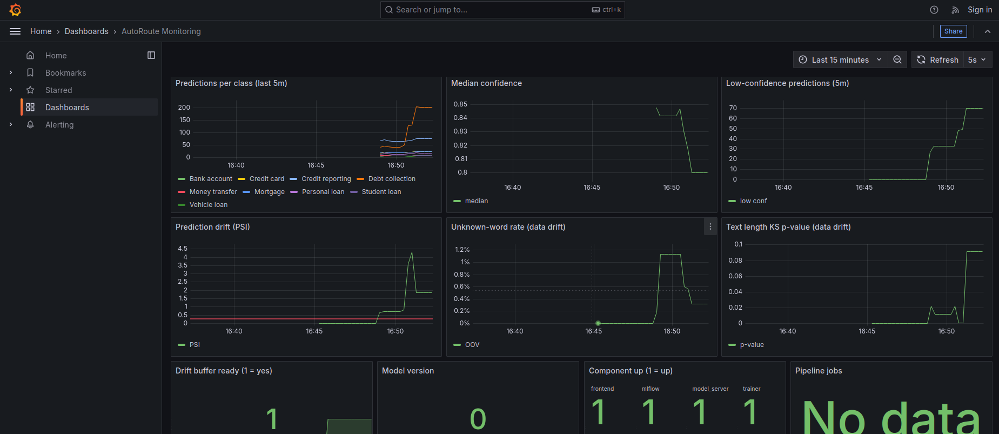
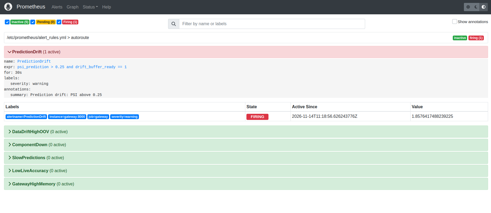

# User Manual

## 1. What AutoRoute does

Customers write complaints about banks, loans, credit cards and similar products. AutoRoute reads one complaint and suggests **which team should handle it**. It also shows how sure it is, which words led to the suggestion, and (for administrators) whether the system is healthy and up to date. You do not need any technical knowledge to use it.

## 2. Getting started

1. Open a web browser (Firefox or Chrome).
2. Type the address of the portal in the address bar. On the machine where AutoRoute is installed it is **http://localhost:8501**. Your administrator will tell you the address if you use it from another computer.
3. The portal opens. On the left you see a menu called **Go to** with four pages: **Classify**, **Pipeline console**, **Health and drift** and **Help**. Click a name to open that page. The line "Backend" under the menu shows which service the portal is talking to; you can ignore it.

## 3. Classify a complaint

This is the page you will use most.

1. Click **Classify** in the menu.
2. Either choose a sample from the list **Or try an example** (for instance "Debt collection"), or choose "(write my own)" and type or paste the complaint into the box **Complaint text**. The counter under the box shows how many of the allowed 5000 characters you used.
3. Press the dark blue **Classify** button and wait a moment ("Analysing...").

**How to read the result**

- **Suggested team** (green box): the team that should receive the complaint, here *Debt collection*.
- **Confidence**: how sure the system is. 98 % means very sure. If the confidence is below 50 % a blue message appears: *"The system is not very sure about this one. A human should double-check it."* Please follow that advice.
- **Top 3 guesses**: the three most likely teams with a score between 0 and 1. The scores add up to about 1 over all teams.
- **Why this category?**: click to open. It lists the words and phrases in your complaint that are typical for the suggested team.
- **Was this suggestion correct?**: press **Yes** or **No**. Each answer helps the administrators measure how accurate the system really is. After you answer you see "Thank you!".

**If something goes wrong**

| What you see | What it means | What to do |
|---|---|---|
| "Please type or paste a complaint first." | The text box is empty | Type or paste a complaint, then press Classify |
| "Cannot reach the AutoRoute service. Please try again in a moment." | The service is busy or starting | Wait a minute and press Classify again; if it keeps happening, tell the administrator |
| A red message such as "Model server unavailable" | The part that makes the prediction is stopped | Tell the administrator; do not route the complaint automatically |
| Very low confidence | The text is unclear or about something unusual | Ask a colleague to check the complaint |

Very long texts are cut off by the box at 5000 characters; if your complaint is longer, paste the most important part.

## 4. Pipeline console

This page is for the people who look after the system. It shows how the model is built and lets you train it again.

- **Current state** at the top: a coloured dot and a word. White/idle = nothing is running, yellow/running = training is in progress, green/success = the last job finished well, red/failed = the last job failed.
- **Retrain model** trains the model again on the current data (a few minutes). **Run full pipeline** repeats every step whose inputs changed. **Refresh** updates the page; press it to follow a running job. The two training buttons are greyed out while a job is running.
- **Pipeline stages**: a picture of the steps from checking the code, cleaning the data and training, to promoting the new model.
- **Speed and throughput**: how many complaints per second were cleaned, how long the cleaning and training took, a bar chart comparing three ways of cleaning (single process, multiprocessing, Ray), and a line such as "Data-quality checks passed | Tests: n passed, 0 failed".
- **Pipeline jobs (successes and failures)**: one row for each job started from this page with its result and duration, and a count of how many succeeded and failed. Open **Latest job log** to read the technical output, for example to see why a job failed.
- **Training runs (MLflow)**: the most recent trainings with the model type, result (macro F1, higher is better), duration and the code version (commit).
- **Current model**: the version of the model in use, its quality (macro F1) and the date it was trained.

A new model is used only if it is good enough (macro F1 at least 0.75) and not worse than the current one. Within about half a minute the service switches to it by itself.

## 5. Health and drift

- **Model Server, Mlflow, Trainer, Frontend**: each shows **Up** when the part is running and **Down** when it is not.
- **Prediction drift (PSI)**: compares the teams the system has recently suggested with the mix it learned from. Under 0.1 = stable, 0.1 to 0.25 = moderate, above 0.25 = **significant**. A significant value means the incoming complaints look different from the past (for example many more debt-collection complaints than usual).
- **Unknown-word rate**: the share of words in recent complaints that the model never saw while learning.
- **Length KS p-value**: tests whether the length of recent complaints differs from the past. A very small number means the lengths have changed.
- **Accuracy confirmed by users**: appears after people have pressed Yes or No on the Classify page.
- Until about 50 complaints have been classified the page says "Collecting data"; the drift numbers appear afterwards.
- Press **Refresh** to update the numbers. Live charts are in Grafana (see section 7).

## 6. Help page

The **Help** page repeats this manual in short form: how to classify, what the Pipeline console shows, how the Yes / No buttons help, what Health and drift means, and what to do when the message "Cannot reach the AutoRoute service" appears (wait a minute and try again; if it continues, ask the administrator to check the services).

## 7. For administrators: other screens

The Pipeline console has links to three tools. They open in a new tab.

**MLflow (http://localhost:5000)** lists every training run and every model version. The version marked **champion** is the one in use.

**Grafana (http://localhost:3000)** shows live charts: predictions per class, confidence, prediction drift (PSI) with the red line at 0.25, unknown words, text length, whether each service is up, model version, memory use and user-confirmed accuracy. Open *Dashboards* and then *AutoRoute Monitoring*; the page refreshes every 5 seconds.

**Prometheus (http://localhost:9090)** collects the numbers and raises alerts. *Status > Targets* shows whether the services are being read; *Alerts* shows which warnings are active.

**What to do when the PredictionDrift alert fires:** open Health and drift, check whether the incoming complaints really changed, then press **Retrain model** in the Pipeline console. If the new model is better it is switched on automatically. If a new model behaves badly, ask the engineer to go back to the previous version (the "champion" label can be moved to an older version).

## 8. Starting and stopping the system (administrator)

Open a terminal in the project folder `~/autoroute`.

- Start everything: `docker compose up -d` (the first start builds the images and can take 10 to 25 minutes).
- Check that all services are healthy: `docker compose ps`.
- Stop everything and keep the data: `docker compose down`.

## 9. Frequently asked questions

**Is my text stored?** The text you type is sent to the local gateway, classified and not written to a database. The system keeps only counts and statistics (for example how many complaints were assigned to each team).

**Why does the system sometimes disagree with me?** It learned from past complaints and is right about 84 out of 100 times on a test set. It is a helper for routing, not a final decision; please use the Yes / No buttons so that mistakes can be measured.

**Which teams can it suggest?** Credit reporting, Debt collection, Credit card, Mortgage, Bank account, Money transfer, Vehicle loan, Student loan and Personal loan.

**Which language should I use?** English.

## 10. Glossary

| Word | Meaning |
|---|---|
| Confidence | How sure the system is about its suggestion |
| Macro F1 | A score from 0 to 1 for how good the model is across all teams; higher is better |
| Champion | The model version that is currently in use |
| Retrain | Teach the model again with the current data |
| Drift | Incoming complaints slowly become different from the ones the model learned from |
| PSI | A number that measures how much the mix of suggested teams has changed |
| Pipeline | The ordered steps that check, clean, learn from and evaluate the data |

