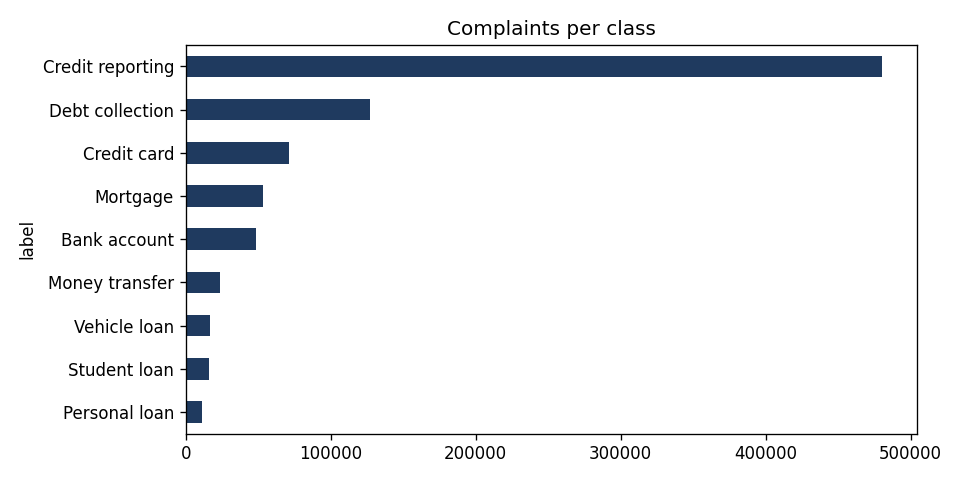
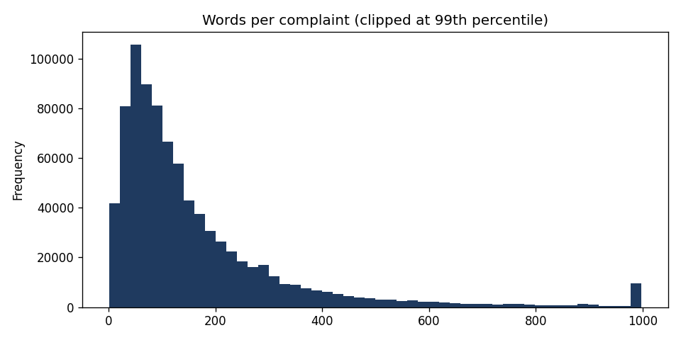
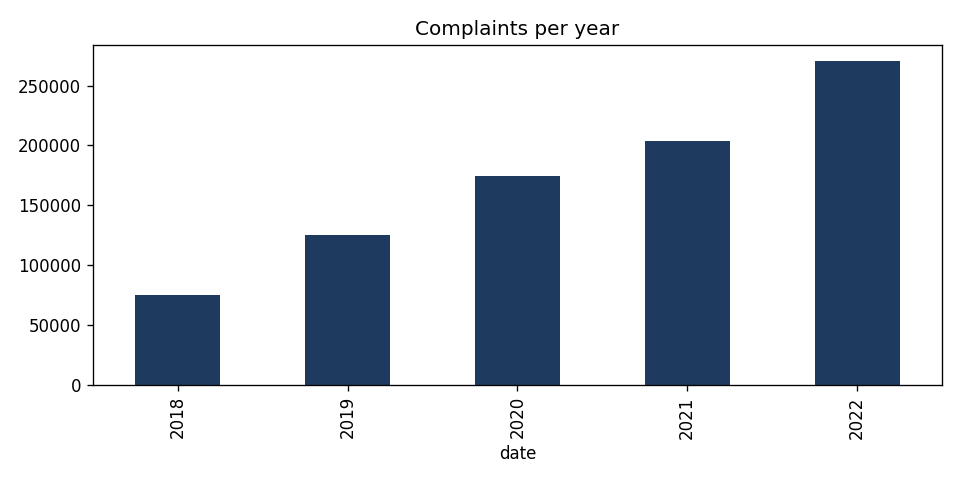

# Data Card

## 1. Overview

| Item | Value |
|---|---|
| Dataset | CFPB Consumer Complaint Database, narratives archive (public data of the US Consumer Financial Protection Bureau) |
| Page | https://www.consumerfinance.gov/foia-requests/foia-electronic-reading-room/cfpb-consumer-complaint-database-narratives-archive/ |
| Files used for training | The two archive exports "May 2018 through April 2021" and "May 2021 through October 2022", downloaded by `scripts/download_data.sh`; unzipped to 3 CSV files (1,491,760,530 bytes) in `data/raw/train` |
| Collection | Version-controlled script `scripts/download_data.sh`; the folder is tracked by DVC (`data/raw/train.dvc`, hash `b4b67e24ce7345f60ad8351e604a854f.dir`), so each Git commit points to the exact data |
| Format | CSV, one complaint per row |
| Columns used | `Date received`, `Product` (the label), `Consumer complaint narrative` (the text) |
| Task | Multi-class text classification: predict the product team from the narrative |

## 2. Size at each step

| Step | Rows |
|---|---|
| Rows read from the CSV files | 847,906 |
| Rows with a narrative, after cleaning (`clean.parquet`) | 847,887 |
| After class filter and cap (classes under 2,000 rows dropped: none; classes capped at 25,000 rows) | about 192,800 |
| Training rows (80 %) / test rows (20 %), stratified, seed 42 | about 154,300 / 38,600 |

The capped, split data are used for the model; the full 847,887 rows are used for the quality checks and the EDA.

## 3. Labels

The raw `Product` names changed over the years, so `label_map.yaml` merges them into 9 classes.

| Class used | Raw product names merged into it | Rows (cleaned) | Share |
|---|---|---|---|
| Credit reporting | Credit reporting, credit repair services, or other personal consumer reports; Credit reporting or other personal consumer reports; Credit reporting | 480,098 | 56.6 % |
| Debt collection | Debt collection | 127,227 | 15.0 % |
| Credit card | Credit card or prepaid card; Credit card; Prepaid card | 71,322 | 8.4 % |
| Mortgage | Mortgage | 53,138 | 6.3 % |
| Bank account | Checking or savings account; Bank account or service | 48,259 | 5.7 % |
| Money transfer | Money transfer, virtual currency, or money service; Money transfers; Virtual currency | 23,666 | 2.8 % |
| Vehicle loan | Vehicle loan or lease | 16,958 | 2.0 % |
| Student loan | Student loan | 15,882 | 1.9 % |
| Personal loan | Payday loan, title loan, or personal loan; Payday loan, title loan, personal loan, or advance loan; Payday loan | 11,337 | 1.3 % |

Merging products changes what a "class" means. For example "Credit card" also contains prepaid cards and "Personal loan" also contains payday and title loans.

## 4. Exploratory data analysis

- 847,887 complaints, 9 classes, median length 108 words per complaint.
- Strong imbalance: the largest class (credit reporting) is 42.3 times larger than the smallest (personal loan).
- The EDA script `src/eda.py` writes three charts and a summary to `docs/eda/`.

## 5. Quality checks (stage `validate`) and results

| Check | Type | Threshold | Value on the real data | Result |
|---|---|---|---|---|
| Required columns present (date, label, text) | hard | all present | none missing | pass |
| Minimum rows | hard | at least 1,000 | 847,887 | pass |
| Minimum classes | hard | at least 2 | 9 | pass |
| No null values | hard | 0 | 0.0 | pass |
| Share of texts shorter than 5 words | hard | at most 20 % | 0.17 % | pass |
| Share of duplicate texts | hard | at most 30 % | 21.9 % | pass |
| Class imbalance ratio | warning | at most 500 | 42.3 | pass |
| Share of unparseable dates | warning | at most 1 % | 0.0 % | pass |

Result: 0 hard failures. The duplicate share is high (21.9 %) because many consumers submit near-identical or templated complaints; it is below the threshold and the duplicates were kept.

## 6. Cleaning and features

- **Cleaning** (`clean_text`): lower case; the redaction marker "XXXX" (and similar runs of x) removed; punctuation removed; spaces collapsed. The same function is used in the pipeline, in the model wrapper and in the gateway, so training and serving see identical text.
- **Features:** TF-IDF on words and word pairs (1 to 2-grams), at most 50,000 features, sub-linear term frequency.

## 7. Potential biases and limitations

- Only complaints whose authors agreed to publish their narrative are included, so the data may not represent all complaints.
- Heavy class imbalance: credit reporting is about 57 % of the data. The model handles it with balanced class weights and is judged by macro F1, but small classes such as personal loan are still harder (F1 about 0.7 against 0.93 for mortgage).
- Product names and categories changed over time and were merged by hand; some complaints could fit several classes.
- Redaction ("XXXX") removes names, dates and amounts, so some details are lost.
- English text about US financial products only; the model should not be used for other languages or countries.
- About 22 % of the texts are duplicates, which can make test scores slightly optimistic if duplicates fall in both train and test sets.
- Newer exports can be kept for drift demonstrations; in this project drift was demonstrated by replaying complaints of a single class through the API (prediction drift).
- The complaints contain personal opinions about companies; no personal identifiers are stored by AutoRoute beyond the text sent for classification, which is not saved.

## 8. Splits and use

Stratified 80/20 split of the capped data with a fixed seed, so every run uses the same test set. The training part also provides the drift baseline (class mix, vocabulary of words seen at least 3 times, and 5,000 text lengths) that the gateway compares live requests with.

